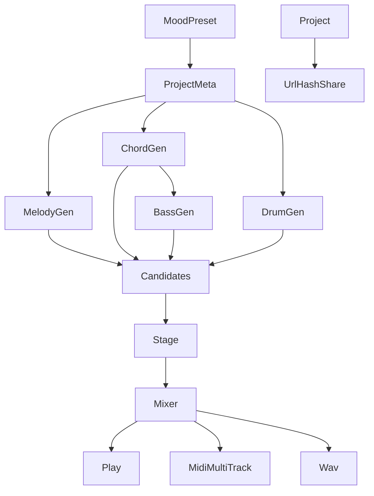

# 雰囲気メロディ — 現状と拡張ロードマップ

最終更新: 2026-09-04

### 実装状況（2026-09）

Phase 0–4 の初期実装済み（レイヤタブ・コード3モード・ベース・ドラム・まとめ再生・キー連動・マルチMIDI）。

キー連動・まとめ再生の確定仕様:

- 「プロジェクトキーに合わせる」はメロディ／コード／ベース各タブ（既定 ON）
- キー連動 OFF 時のまとめ再生は **そのまま再生＋警告のみ**
- コード時間単位は **1 小節に 1 コード**（2 拍は将来）

## 1. 目的とスコープ

**目的**: 作曲が苦手な人でも、「候補を聴いて譜面に並べる」だけで曲らしいものを作れるようにする。

**本ロードマップの方針**: メロディに加え、コード・リズム（ドラム）・ベース・音色・セクション構成・ムードプリセット・MIDI マルチトラック・簡易ミキサー・おまかせ1曲生成・URL 共有をすべて入れる。

**維持する制約**:

- クライアント完結（サーバ不要）
- GitHub Pages 公開（`HashRouter`、`base: /mathematical-music/`）
- 拍子は **4/4 のまま**（拍子拡張は対象外）
- MusicXML・本格楽譜エディタ・クラウド保存・ユーザ認証は **引き続き対象外**

---

## 2. 現状

### 2-1. プロダクト概要

公開中のメイン機能は **雰囲気メロディ**（単旋律の生成・編集・書き出し）。

- 公開 URL: https://motacilo.com/mathematical-music/
- 技術: TypeScript / React / Vite / Tone.js / `@tonejs/midi`
- リポジトリ構成: `apps/web` が唯一のアプリ。`docs/product` に要件メモ。

### 2-2. ユーザーフロー（現状）

```
設定（キー・スケール・BPM・リズム等）
  → 生成（分布 / 数列）
  → 候補を聴く・お気に入り
  → 譜面へ（並べ替え・音高±・小節キー/BPM）
  → 通し再生 / MIDI・WAV 書き出し / 譜面保存
  → ライブラリから再呼び出し
```

### 2-3. 実装済み機能

| 領域 | 内容 |
|------|------|
| 生成 | 分布（ガウス等プリセット・完全ランダム含む）／数列（式・カンマ列）。1〜4 小節。休符確率 |
| リズム | メロディ用スロット（四分・八分・十六分・混合）。4/4 固定。ノート単位のリズム編集 UI なし |
| 編集 | 候補 → 譜面。並べ替え・削除・半音±。候補／譜面のキー・BPM 一括変更 |
| 再生 | Tone.Synth（triangle）1 音色 |
| 書き出し | MIDI 1 トラック `Melody`、WAV オフラインレンダ |
| 永続化 | localStorage（下書き・お気に入り・保存譜面）。sessionStorage（ライブラリ→作曲の一時キュー） |
| その他 | フッターにプライバシー（localStorage・GA4）への導線 |

### 2-4. 主要ファイル

| パス | 役割 |
|------|------|
| `apps/web/src/core/types.ts` | `Note` / `Phrase` / `ProjectSettings` / 生成パラメータ |
| `apps/web/src/core/rhythm.ts` | 4/4・リズムスロット解決 |
| `apps/web/src/core/generators/` | 分布・数列生成 |
| `apps/web/src/pages/ComposerPage.tsx` | 作曲メイン UI |
| `apps/web/src/pages/LibraryPage.tsx` | お気に入り・保存譜面 |
| `apps/web/src/audio/player.ts` | 再生 |
| `apps/web/src/export/midi.ts` / `wav.ts` | 書き出し |
| `apps/web/src/core/composerDraft.ts` / `libraryStore.ts` | 永続化 |

### 2-5. 現状のデータモデル（要約）

- `Note`: pitch（MIDI）・duration・rest
- `Phrase`: notes・bars(1–4)・bpm・keyRoot・scale — **メロディ塊が単位**
- `GenMode`: `distribution` \| `sequence`（「完全ランダム」は分布プリセット）
- スケール: `major` \| `minor` のみ
- プロジェクト全体を表す「マルチトラック」型は **未導入**

### 2-6. 初版で明示的に範囲外だったもの

- 和音・伴奏・ドラム
- MusicXML
- 本格的な楽譜エディタ
- クラウド保存・ユーザ認証

（本ロードマップで、和音・伴奏・ドラムおよび周辺 UX は対象に取り込む。）

---

## 3. 目標プロダクト像

レイヤを並行して持つ **Project** を中心にする。各レイヤで既存と同じく「生成 → 候補を聴く → 譜面へ」を横展開する。

```
Project
├── meta（キー・スケール・BPM・ムード等）
├── sections（Intro / A / B / Outro …）
├── tracks
│   ├── melody
│   ├── chords
│   ├── bass
│   └── drums
└── mixer（音量・ミュート・ソロ）
```



---

## 4. 機能一覧（全部入りの定義）

| # | 機能 | 概要 |
|---|------|------|
| 1 | コード進行 | プリセット進行・キー連動候補・メロディと同時再生 |
| 2 | リズム（ドラム） | Kick / Snare / HiHat 等の簡易パターン候補・密度つまみ |
| 3 | 音色プリセット | レイヤごとの楽器／音色（ピアノ・シンセ等） |
| 4 | ベース | コードからルート／簡易歩行／ペダルを自動生成 |
| 5 | セクション構成 | A/B 等の塊・コピー・繰り返し |
| 6 | ムード／スタイル | 明るい・暗い・疾走などで一括設定 |
| 7 | MIDI マルチトラック | Melody / Chords / Bass / Drums を別トラック書き出し |
| 8 | 簡易ミキサー | レイヤ音量・ミュート・ソロ |
| 9 | おまかせ1曲生成 | 全レイヤ＋セクションを一括生成 |
| 10 | URL 共有 | プロジェクト状態を URL hash に圧縮して共有（サーバなし）。短い試聴は WAV ダウンロードで代替 |

---

## 5. フェーズ別計画

依存の方針（実装順）: **基盤 → コード → ベース → ドラム → まとめ（ミキサー／マルチMIDI）→（後続）音色・セクション・ムード・おまかせ・共有**。

### Phase 0 — データモデルとレイヤタブ基盤

- `Project` / `LayerKind`（`melody` \| `chords` \| `bass` \| `drums`）とミキサー
- レイヤタブ UI（メロディ／コード／ベース／リズム／まとめ）
- 下書きスキーマ移行、マルチレイヤ再生の土台
- 各編集タブの「プロジェクトキーに合わせる」チェック（既定 ON）

### Phase 1 — コード進行

- 3 モード: ランダム／遷移確率（直前依存）／自由選択＋定番進行
- **1 小節に 1 コード**（初期）。2 拍単位は将来拡張
- ローマ数字＋実コード名表示、クローズドトライアド

### Phase 2 — ベース

- コード追従（ルート／5度／簡易歩行）＋ランダム（低音域）
- コード譜面が空のときは追従生成不可＋案内

### Phase 3 — リズム（ドラム）

- Kick / Snare / HiHat。数列なし。密度つまみ
- 既存メロディ用 `rhythmId` とは分離

### Phase 4 — まとめタブ

- 全レイヤ同時再生、音量・ミュート・ソロ
- MIDI マルチトラック、WAV ミックス
- キー不一致時は **そのまま再生＋警告のみ**

### Phase E 以降（後続）

- 音色プリセット、セクション A/B、ムード、おまかせ1曲、URL 共有

---

## 6. データモデル案（骨格）

実装時の出発点。詳細は各 Phase で詰め、破壊的変更時は draft の `version` を上げる。

```ts
type LayerKind = 'melody' | 'chords' | 'bass' | 'drums'

interface ProjectMeta {
  keyRoot: number
  scale: 'major' | 'minor'
  bpm: number
  moodId?: string
  instrumentIds: Partial<Record<LayerKind, string>>
}

interface Section {
  id: string
  name: string // 'A' | 'B' | 'Intro' | ...
  barCount: number
  /** 各レイヤのフレーズ列（小節単位を基本） */
  layers: Record<LayerKind, Phrase[]>
}

interface MixerState {
  volume: Record<LayerKind, number> // 0–1
  mute: Record<LayerKind, boolean>
  solo: Record<LayerKind, boolean>
}

interface Project {
  version: number
  meta: ProjectMeta
  sections: Section[]
  mixer: MixerState
}
```

コード進行は `chords` レイヤ上の専用ノート表現（例: ルート＋quality、または構成音の和音ノート列）とする。ドラムはピッチではなくキットスロット（kick/snare/hat）を表す拡張を検討する。

---

## 7. UX 方針

- **一貫性**: 全レイヤで「生成 → 候補を聴く → 譜面へ」
- **レイヤ切替**: 作曲画面上部またはサイドで Melody / Chords / Bass / Drums を切替
- **同時再生が既定**: 編集中レイヤ以外もミキサー設定に従って聞こえる
- **おまかせ**: 初見向けの大きな導線（詳細つまみは折りたたみ可）
- **ライブラリ**: 当面は Project 単位の保存へ拡張（既存のお気に入り Phrase はメロディ用として移行または併存）

---

## 8. 非対象（このロードマップでもやらない）

- MusicXML
- 本格的な楽譜エディタ（符尾・連桁・改行レイアウト等）
- クラウド保存・ユーザ認証
- 拍子の変更（3/4、6/8 等）
- サーバ経由の音声ホスティング／SNS 直投稿

---

## 9. 成功指標

| 指標 | 目安 |
|------|------|
| 曲っぽさ | コード＋ドラム＋ベースが乗った通し再生が、無操作の「おまかせ」でも成立する |
| 書き出し実用 | Cubase 等で 4 トラック MIDI を読み、レイヤごとに編集できる |
| 完走 | ムード選択 → おまかせ生成 → 微調整 → MIDI/WAV →（任意）URL 共有、まで一人で辿れる |
| 制約遵守 | サーバなし・4/4・Pages 上で動作 |

---

## 10. 関連ドキュメント

- 初版要件: [requirements.md](./requirements.md)
- アプリ README: [../../README.md](../../README.md)
