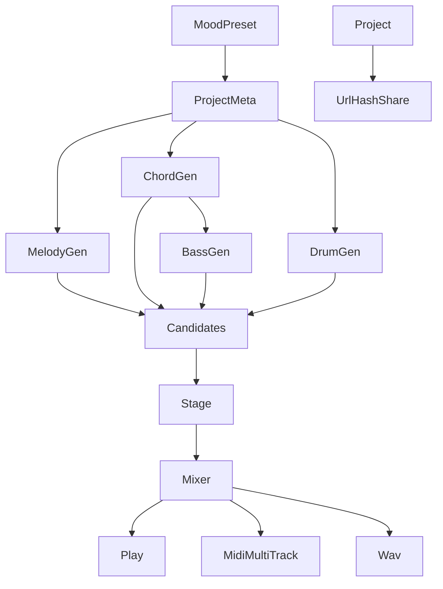

# 雰囲気メロディ — 現状と拡張ロードマップ

最終更新: 2026-11-03

### 実装状況（2026-11）

Phase 0–4 と Phase E の大半を実装済み。未着手は **URL 共有** と **コードの 2 拍単位** のみ。

| # | 機能 | 状況 |
|---|------|------|
| 1 | コード進行 | ✅ ランダム／遷移確率／自由選択＋定番進行。弾き方 8 種（同時押し・パルス・アルペジオ等）。音名／ドレミ表示 |
| 2 | リズム（ドラム） | ✅ Kick / Snare / HiHat。スタイル 7 種＋おまかせ。定番そのまま／ちょいアレンジ／混在 |
| 3 | 音色プリセット | ✅ ピアノ／やわらかい／ギター／オルゴール／鉄琴／木琴（メロディ・コード・ベース別） |
| 4 | ベース | ✅ コード追従／ランダム |
| 5 | セクション構成 | ✅ イントロ・A・B・サビ・間奏・C・後奏。追加・差し替え・削除・区間再生 |
| 6 | ムード | ✅ 明るい／切ない／疾走／おだやか／かっこいい（キー・BPM・音色・ドラム傾向を一括設定） |
| 7 | MIDI マルチトラック | ✅ 出力タブ。含めるパートを選択可 |
| 8 | 簡易ミキサー | ✅ 音量・ミュート・ソロ（再生と WAV 両方に反映） |
| 9 | おまかせ1曲生成 | ✅ はじめるタブ「いまの曲」右上の「おまかせで1曲作る」（11 区間を一括生成）。メロディはコードに合わせて不協和を回避。A/B/サビは 8 小節内で 4+4・2+2+4・4+2+2・なし を確率で選んで繰り返し。リズム型辞書＋曲ごとの個性（音域・跳躍・リズムの手札）で同じ雰囲気でも変化をつける |
| – | ショートBGM | ✅ ショートBGMタブ。長さ（10秒〜3分）と BPM から目標小節数を出し、パターン（A〜F）をドラッグ＆ドロップで並べて合計が合えば作成。割り切れないときは少ない方／多い方を選択。終わり方は そのまま／繰り返し（ドミナント終止＋頭の音へ寄せる）／伸ばす（+1小節、後半休符）。WAV / MIDI 保存 |
| 10 | URL 共有 | ⬜ 未着手 |
| – | ちょいアレンジ | ✅ 候補から高さ違い・数音変更などのバリエーション生成（ロードマップ外で追加） |

確定仕様:

- 「プロジェクトキーに合わせる」はメロディ／コード／ベース各タブ（既定 ON）
- キー連動 OFF 時のまとめ再生・書き出しは **そのまま再生＋警告のみ**
- コード時間単位は **1 小節に 1 コード**（2 拍は将来）
- ムードを変更すると、いまの曲はクリアして作り直す

### 次にやること

1. URL 共有（プロジェクト状態を hash に圧縮）
2. コードの 2 拍単位配置
3. テスト（コード理論・タイムライン・MIDI 書き出しなど純粋ロジック）と CI での lint / 型チェック
4. 成功指標（§9）の確認と、公開向けの OGP・デモ曲整備

## 1. 目的とスコープ

**目的**: 作曲が苦手な人でも、「候補を聴いて譜面に並べる」だけで曲らしいものを作れるようにする。

**本ロードマップの方針**: メロディに加え、コード・リズム（ドラム）・ベース・音色・セクション構成・ムードプリセット・MIDI マルチトラック・簡易ミキサー・おまかせ1曲生成・URL 共有をすべて入れる。

**維持する制約**:

- クライアント完結（サーバ不要）
- GitHub Pages 公開（`HashRouter`、`base: /mathematical-music/`）
- 拍子は **4/4 のまま**（拍子拡張は対象外）
- MusicXML・本格楽譜エディタ・クラウド保存・ユーザ認証は **引き続き対象外**

---

## 2. 現状

### 2-1. プロダクト概要

「雰囲気を選ぶ → 候補を聴く → 並べる」でメロディ・コード・ベース・リズムの入った曲を作る Web アプリ。

- 公開 URL: https://motacilo.com/mathematical-music/
- 技術: TypeScript / React / Vite / Tone.js / `@tonejs/midi`
- リポジトリ構成: `apps/web` が唯一のアプリ。`docs/product` に要件メモ。

### 2-2. ユーザーフロー（現状）

```
はじめる: 雰囲気・音色を選ぶ
  → 区間ごと（区間を選んで 3 候補 → 追加／差し替え） or おまかせで1曲作る（1 曲一括）
  → 通しで聴く
  → 各レイヤタブ（メロディ／コード／ベース／リズム）で微調整
  → 出力: パート選択・ミキサー → WAV / マルチトラック MIDI
  → ライブラリ: お気に入り・保存譜面の再呼び出し
```

タブ: はじめる / メロディ / コード / ベース / リズム / 出力 / ショートBGM（＋ライブラリ）

### 2-3. 主要ファイル

| パス | 役割 |
|------|------|
| `apps/web/src/core/projectTypes.ts` | Project（draft v2）・レイヤ・ミキサー・タブ定義 |
| `apps/web/src/core/ProjectContext.tsx` / `projectStore.ts` | プロジェクト状態と localStorage 永続化（v1→v2 移行） |
| `apps/web/src/core/types.ts` / `rhythm.ts` / `scale.ts` | `Note` / `Phrase`・4/4 リズム・スケール |
| `apps/web/src/core/generators/` | メロディ生成（分布・数列） |
| `apps/web/src/core/chords/` | コード理論・生成・遷移確率・弾き方 |
| `apps/web/src/core/bass/` / `drums/` | ベース・ドラム生成 |
| `apps/web/src/core/sections/` | 区間（役割・生成・タイムライン） |
| `apps/web/src/core/mood/` / `tones/` | ムード・音色プリセット |
| `apps/web/src/core/autofill/` | おまかせ1曲生成 |
| `apps/web/src/core/arrange/` | ちょいアレンジのバリエーション |
| `apps/web/src/pages/` | StartPage / ComposerPage / ChordsPage / BassPage / DrumsPage / ArrangePage（出力）/ BgmPage（ショートBGM）/ LibraryPage |
| `apps/web/src/audio/` | 再生（player・音色 voices・PlaybackContext） |
| `apps/web/src/export/midi.ts` / `wav.ts` | マルチトラック MIDI・ミックス WAV |
| `apps/web/src/core/composerDraft.ts` / `libraryStore.ts` | 下書き・ライブラリ永続化 |

### 2-4. 永続化

- localStorage: プロジェクト下書き（v2）・お気に入り・保存譜面
- sessionStorage: ライブラリ → 作曲の一時キュー

### 2-5. 現状のデータモデル（要約）

- `Note`: pitch（MIDI）・duration・rest／`Phrase`: notes・bars・bpm・keyRoot・scale
- Project draft（version 2）: meta（キー・スケール・BPM）・moodId・tones・sections・各レイヤの候補／譜面・mixer・layerInclude
- コードは `ChordBar`（1 小節 1 コード）、ドラムは `DrumPhrase`（kick / snare / hat スロット）
- スケール: `major` \| `minor` のみ

### 2-6. 初版で明示的に範囲外だったもの

- 和音・伴奏・ドラム
- MusicXML
- 本格的な楽譜エディタ
- クラウド保存・ユーザ認証

（本ロードマップで、和音・伴奏・ドラムおよび周辺 UX は対象に取り込む。）

---

## 3. 目標プロダクト像

レイヤを並行して持つ **Project** を中心にする。各レイヤで既存と同じく「生成 → 候補を聴く → 譜面へ」を横展開する。

```
Project
├── meta（キー・スケール・BPM・ムード等）
├── sections（Intro / A / B / Outro …）
├── tracks
│   ├── melody
│   ├── chords
│   ├── bass
│   └── drums
└── mixer（音量・ミュート・ソロ）
```



---

## 4. 機能一覧（全部入りの定義）

| # | 機能 | 概要 |
|---|------|------|
| 1 | コード進行 | プリセット進行・キー連動候補・メロディと同時再生 |
| 2 | リズム（ドラム） | Kick / Snare / HiHat 等の簡易パターン候補・密度つまみ |
| 3 | 音色プリセット | レイヤごとの楽器／音色（ピアノ・シンセ等） |
| 4 | ベース | コードからルート／簡易歩行／ペダルを自動生成 |
| 5 | セクション構成 | A/B 等の塊・コピー・繰り返し |
| 6 | ムード／スタイル | 明るい・暗い・疾走などで一括設定 |
| 7 | MIDI マルチトラック | Melody / Chords / Bass / Drums を別トラック書き出し |
| 8 | 簡易ミキサー | レイヤ音量・ミュート・ソロ |
| 9 | おまかせ1曲生成 | 全レイヤ＋セクションを一括生成 |
| 10 | URL 共有 | プロジェクト状態を URL hash に圧縮して共有（サーバなし）。短い試聴は WAV ダウンロードで代替 |

---

## 5. フェーズ別計画

依存の方針（実装順）: **基盤 → コード → ベース → ドラム → まとめ（ミキサー／マルチMIDI）→（後続）音色・セクション・ムード・おまかせ・共有**。

### Phase 0 — データモデルとレイヤタブ基盤

- `Project` / `LayerKind`（`melody` \| `chords` \| `bass` \| `drums`）とミキサー
- レイヤタブ UI（メロディ／コード／ベース／リズム／まとめ）
- 下書きスキーマ移行、マルチレイヤ再生の土台
- 各編集タブの「プロジェクトキーに合わせる」チェック（既定 ON）

### Phase 1 — コード進行

- 3 モード: ランダム／遷移確率（直前依存）／自由選択＋定番進行
- **1 小節に 1 コード**（初期）。2 拍単位は将来拡張
- ローマ数字＋実コード名表示、クローズドトライアド

### Phase 2 — ベース

- コード追従（ルート／5度／簡易歩行）＋ランダム（低音域）
- コード譜面が空のときは追従生成不可＋案内

### Phase 3 — リズム（ドラム）

- Kick / Snare / HiHat。数列なし。密度つまみ
- 既存メロディ用 `rhythmId` とは分離

### Phase 4 — まとめタブ

- 全レイヤ同時再生、音量・ミュート・ソロ
- MIDI マルチトラック、WAV ミックス
- キー不一致時は **そのまま再生＋警告のみ**

### Phase E 以降（後続）

- ✅ 音色プリセット、セクション、ムード、おまかせ1曲、ちょいアレンジ
- ⬜ URL 共有
- ⬜ コード 2 拍単位

---

## 6. データモデル案（骨格）

実装時の出発点。詳細は各 Phase で詰め、破壊的変更時は draft の `version` を上げる。

```ts
type LayerKind = 'melody' | 'chords' | 'bass' | 'drums'

interface ProjectMeta {
  keyRoot: number
  scale: 'major' | 'minor'
  bpm: number
  moodId?: string
  instrumentIds: Partial<Record<LayerKind, string>>
}

interface Section {
  id: string
  name: string // 'A' | 'B' | 'Intro' | ...
  barCount: number
  /** 各レイヤのフレーズ列（小節単位を基本） */
  layers: Record<LayerKind, Phrase[]>
}

interface MixerState {
  volume: Record<LayerKind, number> // 0–1
  mute: Record<LayerKind, boolean>
  solo: Record<LayerKind, boolean>
}

interface Project {
  version: number
  meta: ProjectMeta
  sections: Section[]
  mixer: MixerState
}
```

コード進行は `chords` レイヤ上の専用ノート表現（例: ルート＋quality、または構成音の和音ノート列）とする。ドラムはピッチではなくキットスロット（kick/snare/hat）を表す拡張を検討する。

---

## 7. UX 方針

- **一貫性**: 全レイヤで「生成 → 候補を聴く → 譜面へ」
- **レイヤ切替**: 作曲画面上部またはサイドで Melody / Chords / Bass / Drums を切替
- **同時再生が既定**: 編集中レイヤ以外もミキサー設定に従って聞こえる
- **おまかせ**: 初見向けの大きな導線（詳細つまみは折りたたみ可）
- **ライブラリ**: 当面は Project 単位の保存へ拡張（既存のお気に入り Phrase はメロディ用として移行または併存）

---

## 8. 非対象（このロードマップでもやらない）

- MusicXML
- 本格的な楽譜エディタ（符尾・連桁・改行レイアウト等）
- クラウド保存・ユーザ認証
- 拍子の変更（3/4、6/8 等）
- サーバ経由の音声ホスティング／SNS 直投稿

---

## 9. 成功指標

| 指標 | 目安 |
|------|------|
| 曲っぽさ | コード＋ドラム＋ベースが乗った通し再生が、無操作の「おまかせ」でも成立する |
| 書き出し実用 | Cubase 等で 4 トラック MIDI を読み、レイヤごとに編集できる |
| 完走 | ムード選択 → おまかせ生成 → 微調整 → MIDI/WAV →（任意）URL 共有、まで一人で辿れる |
| 制約遵守 | サーバなし・4/4・Pages 上で動作 |

---

## 10. 関連ドキュメント

- 初版要件: [requirements.md](./requirements.md)
- アプリ README: [../../README.md](../../README.md)
